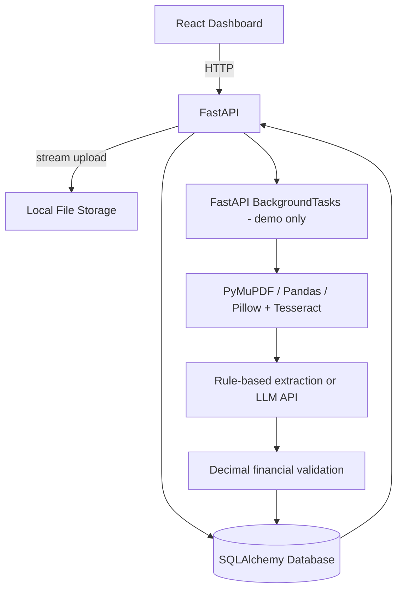

# Architecture and database schema

## Tables

**documents**: id (UUID primary key), filename, sha256, status, created_at, updated_at, extracted_text, data_json, issues_json, error, duration_ms, attempts.

**processing_history**: id (integer primary key), document_id (foreign key), timestamp, event, detail.

`documents` → `processing_history` is one-to-many. `data_json` stores invoice fields and `issues_json` stores validation findings. In production normalize invoice line items and corrections, add indexes and migrations.

## Engineering decisions and tradeoffs
1. Python backend is natural for OCR, PDF and spreadsheet libraries.
2. PyMuPDF extracts selectable text cheaply; OCR is triggered for pages with insufficient text.
3. Decimal avoids binary floating-point comparison errors for financial validation.
4. Missing fields remain null, and deterministic validation catches arithmetic mismatches.
5. BackgroundTasks prevents upload response from waiting but is not durable; Redis/Celery is recommended for deployment.
6. Optional embeddings provide a basic semantic search endpoint; vector indexing and chunking are needed for scale.
7. Current implementation accepts up to 20 files/request and 25 MB/file. A 1000-page scan can still exhaust memory/time; use a durable queue and page-level checkpoints in production.

## Security notes
- Server-side extension and size limits are basic controls, not full file validation.
- Uploaded content is untrusted; document text must not be treated as instructions.
- LLM integration can expose document text to a third party; obtain consent and configure retention policies.
- For production add malware scanning, MIME/magic-byte validation, user auth/RBAC, TLS, rate limits, encrypted storage, audit of corrections, tenant isolation and upload quotas.
